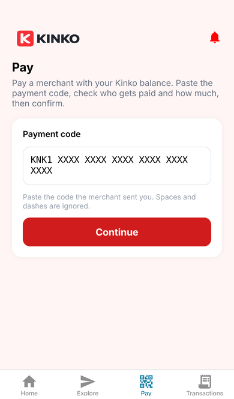
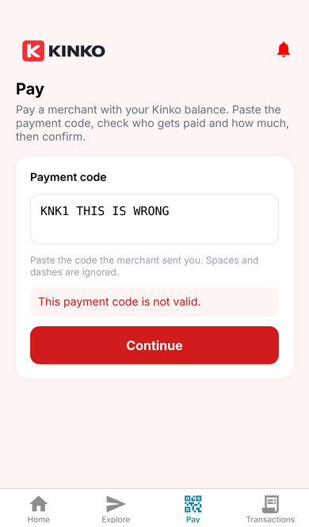
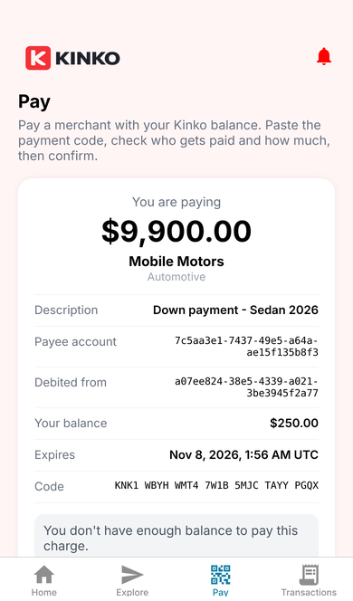
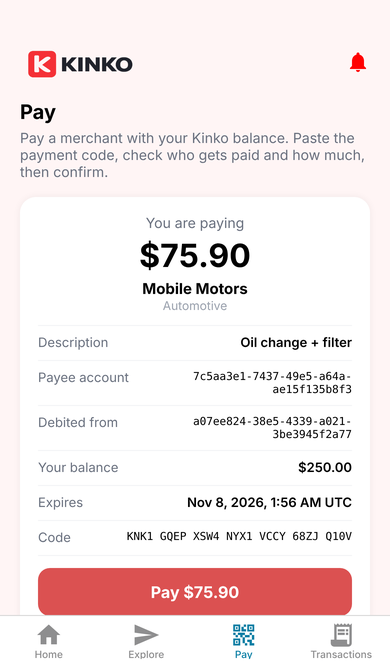
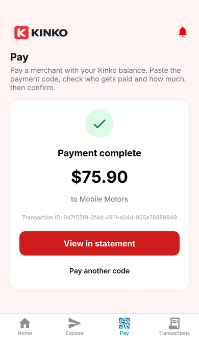
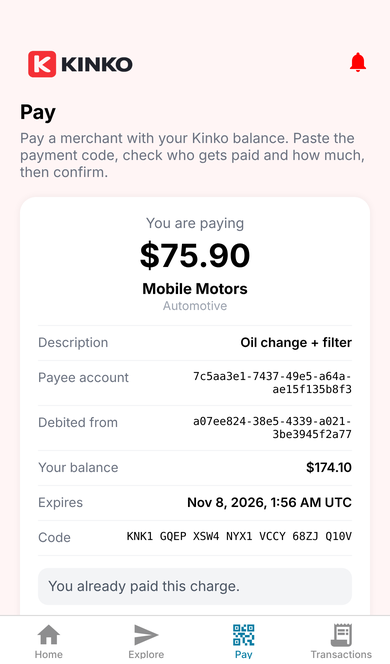
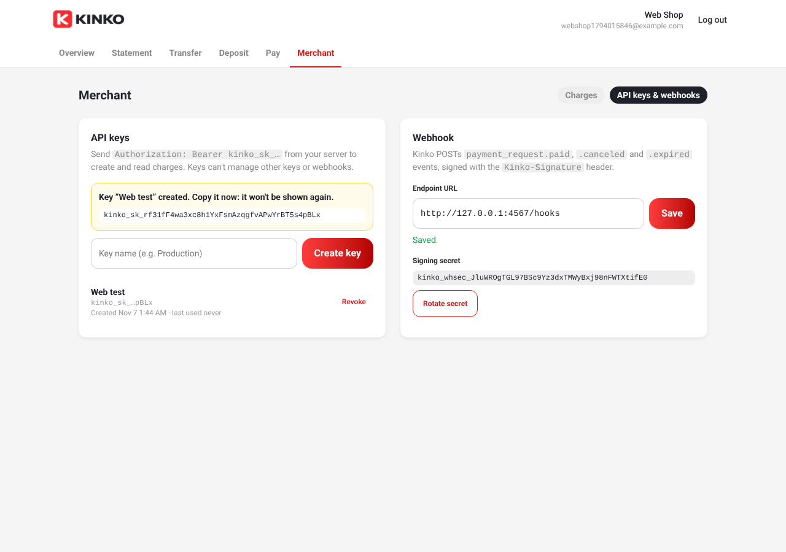
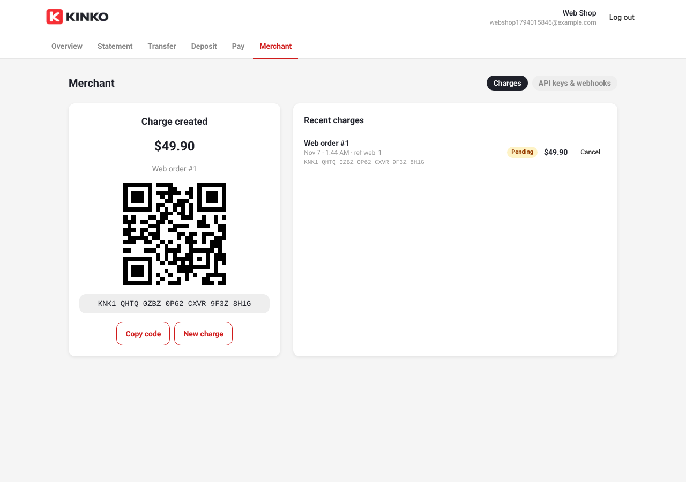
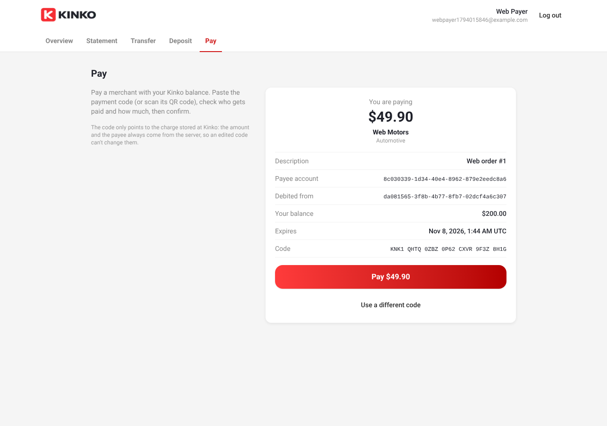
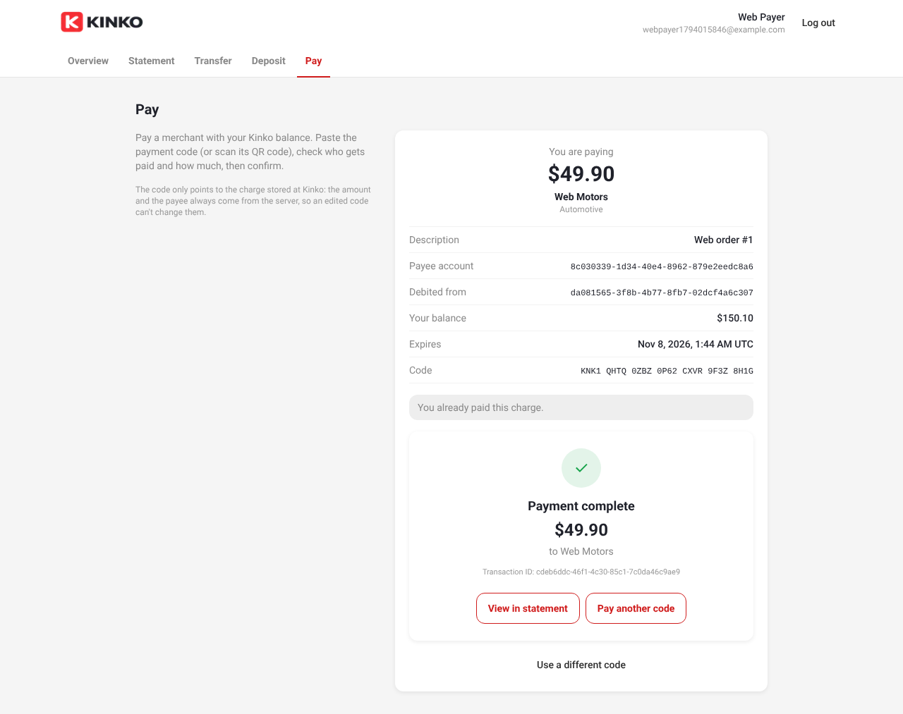

# Payment gateway: screenshots

Captured during the live end-to-end tests of PR #44 (real Rails API + PostgreSQL,
real signed webhooks). The API keys and webhook secrets shown belong to throwaway
users in a local, disposable database.

## Mobile (React Native, iPhone 13)

| Enter code | Invalid code | Insufficient funds |
| :---: | :---: | :---: |
|  |  |  |

| Preview | Payment complete | Reopened: already paid |
| :---: | :---: | :---: |
|  |  |  |

The payer (balance $250.00) is blocked on a $9,900.00 charge, pays a $75.90 charge with
the code pasted using dashes (balance → $174.10), and reopening the code shows
"You already paid this charge". The merchant received the `payment_request.paid` webhook.

## Web (Next.js)

### Merchant: API keys & webhook

### Merchant: charge created (code + QR)

### Payer: preview

### Payer: payment complete

